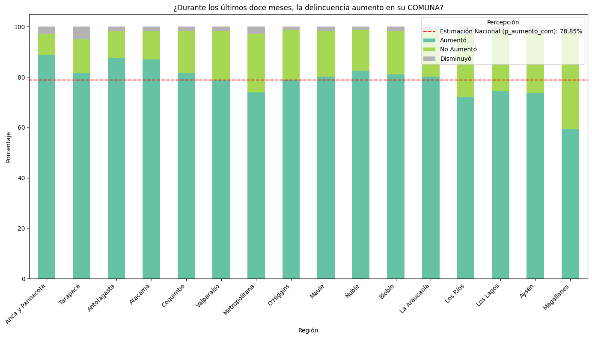
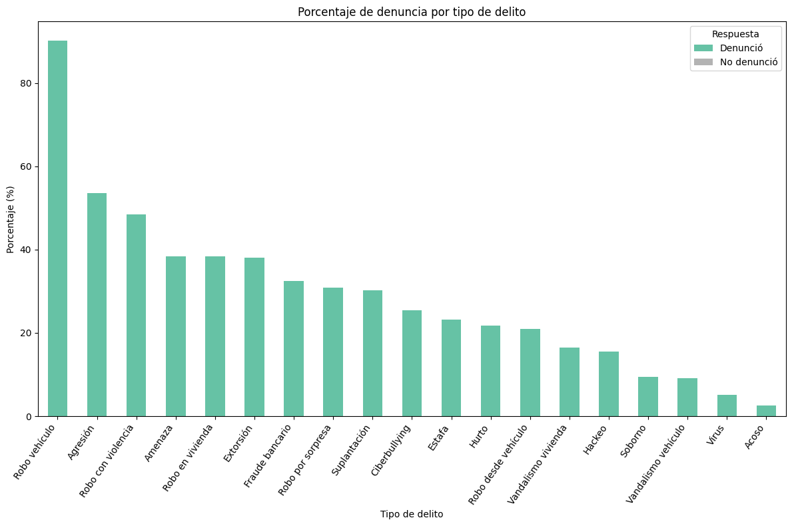
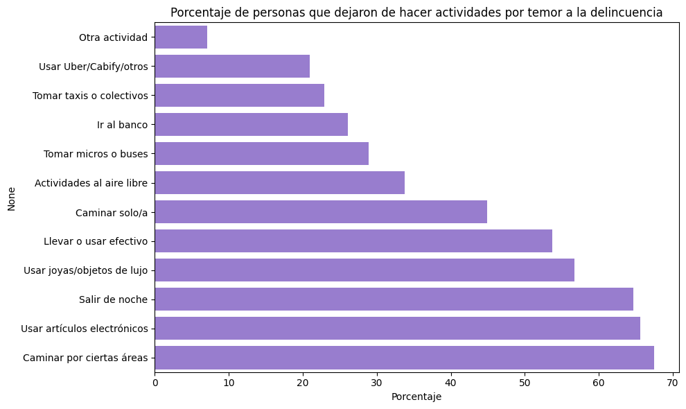
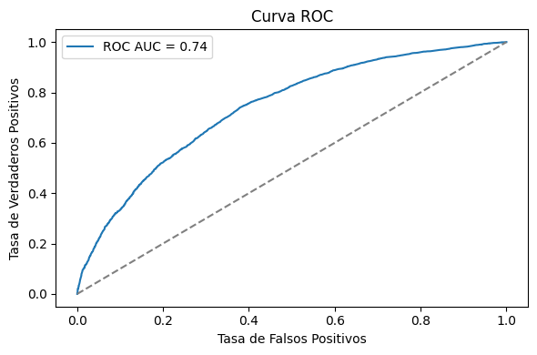

# Percepción de inseguridad y victimización en Chile (ENUSC 2023)

Proyecto del curso **Análisis de Datos** (Universidad de Concepción, 2025), profesora Mabel Vidal. Trabajo en grupo: Cristóbal Figueroa, Vicente Ríos, Joaquín San Martín y Mario Salgado Orellana.

> **Mi aporte:** participé en todas las etapas del proyecto: la selección y limpieza de las variables de la encuesta, el análisis exploratorio, el modelo de regresión logística y la versión final del análisis.

**¿La gente se siente más insegura de lo que indica la delincuencia que realmente sufre?** Analizamos la **Encuesta Nacional Urbana de Seguridad Ciudadana (ENUSC) 2023** del INE, con **146.294 registros y 1.301 variables**, para estudiar la brecha entre la **percepción de inseguridad** y la **victimización real**, qué factores se asocian a esa percepción (edad, nivel socioeconómico, fuentes de información, haber sido víctima) y cómo el temor cambia la vida cotidiana. Además, entrenamos un **modelo de regresión logística** que predice si una persona percibe que la delincuencia aumentó en su barrio.

<details>
<summary><b>🇬🇧 English summary</b></summary>

<br>

**Perceived insecurity vs. actual victimization in Chile (ENUSC 2023).** Course project for *Data Analysis* at the University of Concepción (Chile), 2025. Team project.

**Question:** do people feel less safe than the crime they actually experience would suggest? We analyzed Chile's national urban crime survey (ENUSC 2023, 146,294 records and 1,301 variables) with pandas, Matplotlib and seaborn, and trained a logistic regression model with scikit-learn.

**Key findings**
- **Insecurity is perceived as something that happens elsewhere.** About 90% of respondents think crime increased in the country, 79% in their municipality and 48% in their own neighborhood (average across regions).
- **Victimization explains little of the perception.** The correlation between the number of crimes suffered and perceived insecurity is only 0.08; even among non-victims, 76% think crime increased in their municipality.
- **Lower socioeconomic status, higher perceived insecurity:** 92% in the low group vs. 81% in the high group.
- **Harassment is the most reported crime and the least reported to the police** (2.5%).
- **Fear changes daily life:** 67% avoid certain areas and 65% stopped going out at night.
- **Model:** a logistic regression predicts whether a person perceives that crime increased in their neighborhood with 68% accuracy and an AUC of 0.74.

**My contribution:** I took part in every stage of the project: variable selection and data cleaning, exploratory analysis, the logistic regression model and the final version of the analysis.

**Stack:** Python, pandas, NumPy, Matplotlib, seaborn, scikit-learn, Jupyter.

</details>

## Resultados principales

| Hallazgo | Evidencia |
|---|---|
| **La inseguridad se percibe "lejos"** | Promediando las regiones, el **90 %** cree que la delincuencia aumentó en el país, el **79 %** en su comuna y solo el **48 %** en su barrio. |
| **Haber sido víctima explica poco la percepción** | La correlación entre el número de delitos sufridos y la percepción de inseguridad es de apenas **0,08**. Cree que la delincuencia aumentó en su comuna el 83 % de las víctimas, pero también el 76 % de quienes no lo han sido. |
| **Menor nivel socioeconómico, más percepción de inseguridad** | Cree que la delincuencia aumentó en el país el **92 %** del NSE bajo, frente al **81 %** del NSE alto. |
| **El delito más frecuente es el que menos se denuncia** | El acoso es el delito más reportado (4.264 personas), pero solo lo denuncia el **2,5 %**. El robo de vehículo, en cambio, se denuncia en el **90 %** de los casos. |
| **El temor cambia la vida cotidiana** | El **67 %** dejó de caminar por ciertas zonas, el 66 % de usar artículos electrónicos en la calle y el **65 %** de salir de noche. |
| **El modelo distingue de forma aceptable** | La regresión logística predice si una persona percibe un aumento de la delincuencia en su barrio con **accuracy de 0,68** y **AUC de 0,74**. |







Todas las figuras están en [`figuras/`](figuras/).

## Metodología

- **Datos:** ENUSC 2023 del [INE](https://www.ine.gob.cl/enusc), base de usuario con 146.294 registros y 1.301 variables (ver [`datos/README.md`](datos/README.md)).
- **Limpieza:** selección de las variables de interés con el diccionario de la encuesta. Muchas variables tienen más del 97 % de nulos porque las preguntas dependen de respuestas anteriores. Los códigos especiales 85 (no aplica), 88 (no sabe) y 99 (no responde) se tratan como faltantes.
- **Análisis exploratorio:** percepción por región, comuna y barrio, edad y nivel socioeconómico; frecuencia y denuncia de 19 tipos de delito; influencia de las fuentes de información, y cruces entre percepción, victimización y cambios de rutina.
- **Modelo:** regresión logística (scikit-learn) para predecir si una persona percibe que la delincuencia aumentó en su barrio, a partir de 8 variables: edad, sexo, nivel educacional, NSE, victimización del hogar, exposición al delito e inseguridad de día y de noche. Se usaron 41.457 personas con respuestas completas, divididas en 70 % entrenamiento y 30 % prueba de forma estratificada.



## Limitaciones

- **Sin factores de expansión.** Los porcentajes corresponden a las personas encuestadas, no son estimaciones poblacionales como las que publica el INE, que pondera cada respuesta.
- **Correlación no es causalidad.** Los cruces muestran asociaciones; por ejemplo, no permiten afirmar que el nivel socioeconómico cause una mayor percepción de inseguridad.
- **Modelo básico.** Las variables categóricas se usaron como números, sin codificarlas ni escalarlas, y no se compararon otros modelos. Su desempeño es moderado.
- **Gráfico de denuncias.** En la ENUSC la respuesta «No» se codifica como 2, pero el código cuenta «No denunció» con el valor 0, así que esa parte de las barras queda vacía. El porcentaje de «Denunció» sí es correcto. Por el mismo motivo, en la entrega 2 se informó que el 84,5 % de las víctimas de hackeo denunció, cuando el valor correcto es el 15,5 %.

## Estructura

```
├── notebooks/
│   ├── 01_extraccion_y_exploracion.ipynb    entrega 2: carga, variables y primeros gráficos
│   ├── 02_modelo_regresion_logistica.ipynb  entrega 3: modelo de regresión logística
│   └── 03_analisis_final.ipynb              entrega 4: análisis final
├── figuras/                                 gráficos del análisis final y del modelo
├── datos/                                   base de la ENUSC (no se sube; ver datos/README.md)
└── docs/                                    informes de las entregas 1 y 2
```

Los notebooks conservan las salidas de cuando se ejecutaron. Las notas marcadas como *revisión posterior* corrigen o precisan algunas interpretaciones sin cambiar el código.

## Cómo correrlo

```bash
pip install -r requirements.txt
```

1. Descarga la base de la ENUSC 2023 en `datos/` (ver [`datos/README.md`](datos/README.md)).
2. Abre los notebooks desde la carpeta `notebooks/`. Leen la base desde `../datos/`.

Python 3.12.

## Documentos

- [`docs/entrega1_descripcion_del_proyecto.pdf`](docs/entrega1_descripcion_del_proyecto.pdf): problema, objetivos y relevancia.
- [`docs/entrega2_extraccion_y_exploracion.pdf`](docs/entrega2_extraccion_y_exploracion.pdf): descripción de los datos, limpieza y primer análisis exploratorio.
- La entrega 4 (documento final) es el notebook [`03_analisis_final.ipynb`](notebooks/03_analisis_final.ipynb).

## Referencias

- Instituto Nacional de Estadísticas (2024). *Encuesta Nacional Urbana de Seguridad Ciudadana (ENUSC) 2023*. https://www.ine.gob.cl/enusc
- Prieto Curiel, R. y Bishop, S. R. (2016). *A metric of the difference between perception of security and victimisation rates*. Crime Science.
- Valera, S. y Guàrdia, J. (2014). *Perceived insecurity and fear of crime in a city with low-crime rates*. Journal of Environmental Psychology.
